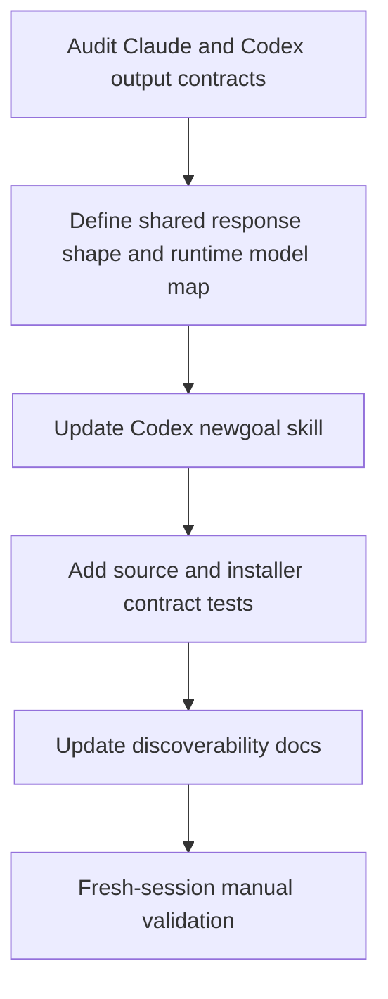

# Archived plan — GOALS 14: Codex Model Recommendation Parity for `$newgoal`

> Status: superseded by GOALS 19 (the model + effort suggestion was removed). Archived from root `GOALS.md` on 2026-10-28.
> This body is a historical snapshot; keep it immutable and add future active work to root `GOALS.md`.

---

## GOALS 14 — Codex Model Recommendation Parity for `$newgoal` (base_project feature)

The Claude command already ends a successful `/newgoal` run with a localized, bold model +
effort recommendation and an explicit manual-only disclaimer. The Codex skill has a related
instruction, but its model vocabulary is still Claude-specific (`haiku`/`sonnet`/`opus`) and
does not define the visible response shape strongly enough. This goal makes `$newgoal` behave
the same way at the interaction level while using Codex's own current model names and effort
levels.

Suggested: gpt-5.6-sol · high — the change is bounded but spans Codex prompt semantics, cross-runtime contract tests, installed projection, and a live behavior check.

### Design rationale

- [x] **M14.1 Define the parity contract** (`architect`) — use the Claude final-response rule as
  the semantic reference, not as a claim that OpenCode currently emits the same visible line.
  After the path and short outline, Codex must emit exactly one localized recommendation sentence
  with one bold `<Codex model> · <effort>` pair, one reason tied to the plan's highest-complexity/
  highest-risk module, the manual-only disclaimer, and the question asking whether to continue
  with `$execgoals` or adjust the plan. **Done when:** the architect confirmed these four
  invariants and the implementation/test items encode them. Proof: read-only architecture review
  completed by the `architect` subagent; no files were edited by that review.
- [x] **M14.2 Define Codex-specific recommendation mapping** (`architect`) — keep Claude and
  OpenCode's `haiku`/`sonnet`/`opus` vocabulary unchanged, but make Codex recommend the model
  actually usable in the current Codex session: `gpt-5.6-luna · low` for mechanical routine work,
  `gpt-5.6-terra · medium` for typical implementation, `gpt-5.6-sol · high` for difficult
  multi-system work, and `gpt-6-astra · xhigh` for high-cost-of-failure work. Resolve availability
  against the models visible in the active Codex surface; fall back along Astra → Sol → Terra →
  Luna, preserve effort when supported, and disclose any fallback. Never print Claude model names
  as Codex choices. **Done when:** the architect approved this deterministic mapping and the plan
  metadata uses the selected Codex pair. Proof: current official model roles and the available
  Codex model surface were reviewed; Sol/Astra ambiguity was removed.
- [x] **M14.3 Preserve scope boundaries** (`architect`) — do not change the active model,
  reasoning setting, `fallbackModel`, global Codex configuration, billing behavior, command
  count, menu entries, or any workflow other than `$newgoal`. The recommendation remains advice
  applied by hand, never an automatic mid-session switch. **Done when:** the architect confirmed
  the out-of-scope list and no file outside the approved paths is required. Proof: the read-only
  architecture review approved this boundary.

### Implementation

- [x] **M14.4 Make the Codex final-response contract explicit** (`coder`) — update
  `source/codex/skills/newgoal/SKILL.md` so the final response cannot be satisfied by merely
  mentioning a `Suggested:` line inside `GOALS.md`: require the visible localized sentence,
  bold model/effort pair, plan-specific reason, manual-only disclaimer, and `$execgoals` versus
  plan-adjustment question. Keep the planning-only boundary and the Codex-native `$` spelling.
  Replace the Claude-only model set in the Codex-specific guidance with the approved Codex map;
  do not copy the full Claude command or add a new skill.
  **Done when:** the source skill contains one unambiguous final-response contract, uses
  Codex-compatible model identifiers, and preserves `never execute`. **Proof:**
  `source/codex/skills/newgoal/SKILL.md` now contains the explicit localized final-response
  contract and Codex model mapping.
- [x] **M14.5 Keep source and installed projections aligned** (`coder`) — rely on the existing
  `dev/scripts/install-codex.js` source-of-truth flow; do not edit `~/.agents/skills/` manually or
  change the installer for a content-only skill update. Exercise the temporary-root installer
  path so the installed Codex skill receives the same contract and existing user-owned skill
  content remains preserved. **Done when:** the temporary installed file is byte-equivalent to
  the managed source file and the existing idempotency/user-collision tests still pass. **Proof:**
  the installer test compares the temporary installed skill byte-for-byte with source and passes
  while preserving a user-owned colliding skill.

### Tests

- [x] **M14.6 Add deterministic cross-runtime contract coverage** (`coder`) — extend
  `dev/tests/codex.test.js` with a focused assertion over
  `source/claude/commands/newgoal.md`, `source/opencode/command/newgoal.md`,
  `source/opencode/command-lite/newgoal.md`, and `source/codex/skills/newgoal/SKILL.md`:
  Claude/OpenCode retain their existing model-tier contract; Codex has the visible final-output
  contract, Codex model vocabulary, localized-output instruction, and manual/no-auto-switch
  disclaimer; none loses the planning-only boundary. Assert the Codex-specific section does not
  present `haiku`/`sonnet`/`opus` as Codex models.
  **Done when:** the test fails if the Codex instruction regresses to a GOALS-only suggestion or
  to Claude model names, and it passes against all four source variants. **Proof:**
  `node --test dev/tests/codex.test.js` passed 6/6.
- [x] **M14.7 Verify the complete local quality gate** (`reviewer`) — run the repository's own
  checks after the source/test edits: `npm test`, `npm run lint`, `npm run typecheck`,
  `npm run validate:plugins`, `npm run check:unused-deps`, `npm run test:harness`, and
  `git diff --check` for the owned paths. **Done when:** all checks pass and no unrelated dirty
  work is staged, reverted, or rewritten. **Proof:** `npm run verify` passed (Biome 56 files,
  typecheck, plugin validation, unused-dependency check, full test suite 127/127, and audit with
  0 vulnerabilities); `npm run test:harness` passed 12/12 artifacts and 16/16 scenarios; GOALS
  structure and `git diff --check` passed.
- [x] **M14.8 Confirm real Codex behavior in a fresh session** (`manual`) — after synchronization,
  *(Closed unperformed on 2026-10-28: GOALS 19 removed the feature this check would have confirmed.)*
  invoke `$newgoal` on a disposable harmless project and inspect the actual final response. It
  must show the localized bold model + effort recommendation, a reason, the manual-only warning,
  and the execution/adjustment question; it must not change the selected model or effort. Record
  the exact observed model/effort and the session/date because prompt tests cannot prove a
  probabilistic model followed its instruction. **Done when:** the live response matches the
  contract, or a concrete Codex limitation is recorded instead of claiming success. **Proof:**
  Codex global synchronization completed successfully; the installed skill's SHA-256 matches
  the source (`D09A8898ECA6D77499C89056188BE1C28C40274E87DD208ACA3F0B7A55B88ADE`). **Current
  blocker:** opening a fresh Codex session and observing the live `$newgoal` response is still
  required; installation and structural checks do not prove model obedience.

### Registration

- [x] **M14.9 Document the runtime distinction without creating another command** (`coder`) —
  update the existing `/newgoal` description in `README.md` and the Codex integration note in
  `source/codex/README.md` to explain that the recommendation is manual and that each runtime
  uses its own model vocabulary. Do not add a menu/status entry or change the 20/20 command-skill
  parity counts. **Done when:** the existing user-facing `/newgoal` entry and Codex README agree
  with the implemented behavior and the command-count tests remain unchanged. **Proof:**
  `README.md` and `source/codex/README.md` document the runtime-specific manual mapping; stale
  21-workflow wording was corrected to 20; no menu or parity-count change was made.
- [x] **M14.10 Record the decision in the chronological roadmap** (`coder`) — add a concise
  `dev/ROADMAP.md` entry referencing this goal, the runtime-specific model mapping, the source
  paths, and the honest limit that structural tests do not prove live model obedience.
  **Done when:** the roadmap points to the shipped contract and does not imply automatic model
  routing or live validation unless M14.8 produced that evidence. **Proof:** `dev/ROADMAP.md`
  item 51 records the mapping, fallback, files, and structural-test/live-obedience limitation.

### Explicitly out of scope

- Automatic model/effort switching, model routing middleware, `fallbackModel`, or changes to
  Codex/Claude account settings.
- A new command, a model API, billing/token instrumentation, or recommendations for every
  workflow beyond `$newgoal`.
- Replacing the existing Claude/OpenCode vocabulary or pretending that Claude model names are
  valid Codex model selections.
- Treating a passing string/structure test as proof that every live model will obey the prompt;
  M14.8 remains a separate manual check.

### Sources consulted

- [OpenAI Models](https://developers.openai.com/api/docs/models) — current model roles and
  reasoning-effort ranges used to keep Codex recommendations runtime-aware; availability and
  account access remain session-dependent.
- `source/claude/commands/newgoal.md`, `source/opencode/command/newgoal.md`,
  `source/opencode/command-lite/newgoal.md`, and `source/codex/skills/newgoal/SKILL.md` — current
  source contracts and the exact parity gap.
- `dev/tests/codex.test.js` and `dev/scripts/install-codex.js` — existing cross-runtime and
  source-to-installed verification boundaries.
