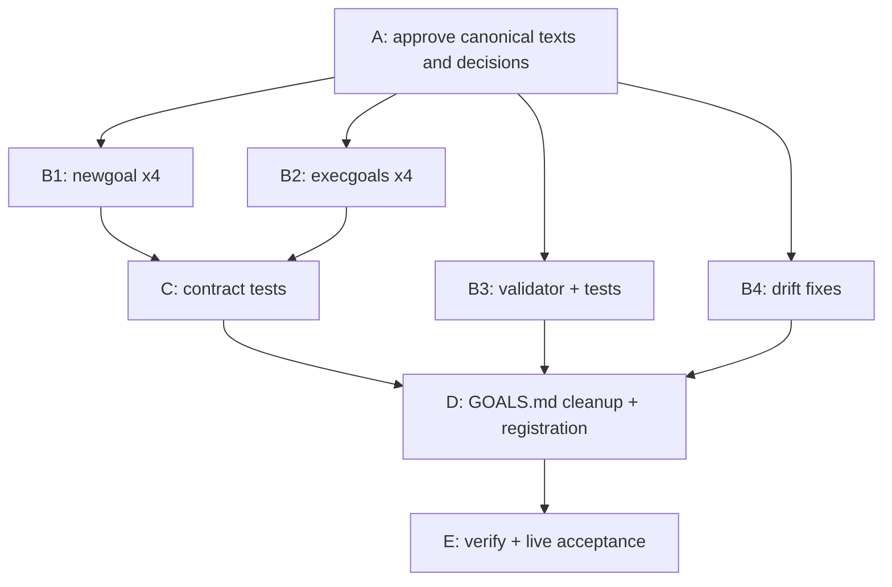

# Archived plan — GOALS 19 — Plan-Heavy, Build-Light: Executable Item Contract

> Status: completed. Archived from root `GOALS.md` on 2026-10-28.
> This body is a historical snapshot; keep it immutable and add future active work to root `GOALS.md`.

---

<a id="goals-19-plan-heavy-build-light-executable-item-contract"></a>
## GOALS 19 — Plan-Heavy, Build-Light: Executable Item Contract (base_project process)

Grounded against commit `d541daf` on 2026-10-27. The goal workflow should spend its reasoning
in `/newgoal`, so `/execgoals` can run on a weaker or cheaper model that only transcribes,
runs the stated check, and stops when reality differs from the plan. Today the opposite leaks
through: items describe intent rather than exact edits, nothing forces the planner to verify
the paths and names it cites, `/execgoals` re-runs a design pass (`architect`) on work that was
already designed, and there is no rule for what to do when the plan no longer matches the files.
The owner also asked to remove the per-module model + effort suggestion from every rule, and
to write plan items in the style of ASD-STE100 Simplified Technical English (no rule mentions
STE today). This plan does all three, and fixes the inconsistencies found while auditing the
goal workflow.

### Stage map

| Stage | Items | Depends on | Can run in parallel with |
| --- | --- | --- | --- |
| A — Approve texts and decisions | P19.1 | — | — |
| B1 — `/newgoal` rewrite (4 variants) | P19.2–P19.5 | A | B2, B3, B4 |
| B2 — `/execgoals` rewrite (4 variants) | P19.6–P19.9 | A | B1, B3, B4 |
| B3 — Structure validator enforces the contract | P19.10–P19.11 | A | B1, B2, B4 |
| B4 — Drift fixes outside the commands | P19.12–P19.14 | A | B1, B2, B3 |
| C — Contract tests | P19.15–P19.16 | B1, B2 | — |
| D — `GOALS.md` cleanup and registration | P19.17–P19.20 | C, B3, B4 | — |
| E — Verification and live acceptance | P19.21–P19.23 | D | — |

B2 and GOALS 18's C18.5 edit the same four `execgoals` files: never run them in parallel
sessions. Stage D edits `GOALS.md` itself, so it runs in the session that is executing this plan.



<!-- item-contract: v1 -->

### Audit findings (evidence this plan rests on)

- **F1 — model suggestion surfaces.** `source/claude/commands/newgoal.md:102-114` (5a) and
  `:127-131` (step 7); `source/opencode/command/newgoal.md` (same lines); 
  `source/opencode/command-lite/newgoal.md:43` (STEP 7a); `source/codex/skills/newgoal/SKILL.md:21-28`
  (mapping), `:30` (step 6 sentence), `:33-40` (step 9 contract); `README.md:119` and `:154`;
  `source/codex/README.md:28`; `dev/tests/codex.test.js:155-228`; `Suggested:` lines in this
  file's GOALS 18, 17, 16, 15, 14; GOALS 14 exists only to build this feature (M14.8 open).
- **F2 — the policy contradicted itself.** 5a existed so modules could be dialed *down*; step 7
  recommended the setting of the riskiest module, which pushes the whole run *up*. Moot after
  removal.
- **F3 — lite drift.** `source/opencode/command-lite/newgoal.md` STEP 9 never asks whether to run
  `/execgoals` or adjust the plan; the dense and Codex variants do.
- **F4 — design paid twice.** `/execgoals` step 3 sends every non-trivial item through
  `architect` → `coder` (`source/claude/commands/execgoals.md:35-36`), and `architect` runs on
  `opus` (`source/claude/agents/architect.md:5`), even when `/newgoal` already settled the design.
- **F5 — no grounding contract.** The goal-type modules only require a "done when"; nothing
  requires verified paths, verbatim anchors, an exact check, or a source for external facts.
  `dev/scripts/validate-goals-structure.js` checks only duplicate IDs and unclosed Mermaid
  fences. Recent plans are precise by habit (GOALS 18), not by rule.
- **F6 — no plan-drift stop.** If an anchor or file named by the plan has changed, no variant of
  `/execgoals` says to stop; the executor improvises. This is the main hallucination path for a
  weaker executor.
- **F7 — `@types/node` major drift.** `package.json:24` has `"@types/node": "^26.6.5"` (Dependabot
  PR #14, merged), while `CLAUDE.md:93-94` requires the major of the CI's Node, and
  `.github/workflows/ci.yml:18,42` pin `node-version: 22`. `.github/dependabot.yml` has no
  `ignore` rule, so the next major bump will repeat this.
- **F8 — archive checksum by hand.** All four `execgoals` variants tell the executor to compute
  the SHA-256 and append the archive row by hand (`execgoals.md:54-62`), while `CLAUDE.md`
  (root) says the checksum column is never edited by hand in this repo: run
  `node dev/scripts/goals-archive-index.js --write`.
- **F9 — cross-runtime path coupling (documented, not changed).** The opencode dense and Codex
  `execgoals` run `~/.claude/base_project/scripts/validate-goals-structure.js`. That works only
  because both installers always install the Claude layer (`install.ps1:572`,
  `install.sh:480`; no engine flag exists). Left as is; recorded so a future engine flag knows
  this dependency exists.
- **F10 — checked and fine.** `node dev/scripts/validate-goals-structure.js GOALS.md` → structure
  OK; `node dev/scripts/goals-archive-index.js --check` → 12 checksums OK; Codex reads the
  goal-type modules from the shared Claude references (`dev/scripts/install-codex.js:169`), so no
  third copy is needed. Session-level effort guidance (`Quality-per-token profiles` in
  `source/CLAUDE.md`) and the agents' `model:` frontmatter are not plan-time suggestions and stay.

### Decisions

- **D1 — Remove, do not rewrite history.** The model + effort suggestion leaves every current
  source, doc, test, and the active `GOALS.md`. Archived plans (`dev/goals-archive/`) and earlier
  `dev/ROADMAP.md` entries stay untouched — they are append-only history; a new ROADMAP entry
  records the removal.
- **D2 — Keep session effort profiles and agent models.** Out of the owner's ask (see F10).
- **D3 — Contract enforced only where declared.** The validator checks contract fields only
  below a `<!-- item-contract: v1 -->` marker, so every existing plan stays valid.
- **D4 — `architect` only for open design.** `/execgoals` sends a fully specified item straight
  to `coder`; `architect` runs first only when the owner is `architect` or the item's `Change:`
  is a specification that still leaves a design question.
- **D5 — Parallel stages are advice, not a scheduler.** `/execgoals` keeps running items in
  written order; the stage map tells the user which stages may go to separate sessions.
- **D6 — `@types/node` follows the rule.** Revert to major 22 and stop Dependabot from proposing
  majors for it. If the owner prefers to follow Node 26 instead, P19.12 changes to "update CI to
  Node 26 and the rule's number" — say so at P19.1.
- **D7 — Archive checksum via the project's own command when it names one.** `/execgoals` runs
  the command that the project's `CLAUDE.md` names for writing archive checksums (in this
  repository: `node dev/scripts/goals-archive-index.js --write`), and keeps the by-hand path for
  other projects. The shipped text cannot name that script: `dev/tests/command-paths.test.js`
  forbids `dev/scripts/*.js` paths in shipped commands (corrected during execution).
- **D8 — STE style, not STE conformance.** Item text follows a short subset of ASD-STE100
  rules (T9). base_project does not ship the STE dictionary (about 900 approved words; the
  specification is free but distributed by ASD through a request form) and does not claim
  conformance. The 20/25-word limits are base_project's own adopted rule, taken from the STE
  practice below; the rationale sections of a plan stay in normal English.

### Canonical texts

Items below paste these blocks verbatim. Codex variants replace `/execgoals` with `$execgoals`
and `/newgoal` with `$newgoal`. Lite variants keep every word but put each block on one
paragraph after its `STEP` label (sub-bullets become sentences separated by `; `).

**T1 — newgoal step 4c (grounding)**

```text
4c. **Ground every reference before writing it.** Open each file the plan will edit and copy
    its anchors from what is actually there; search for every function, flag, path, command,
    and test name the plan mentions and correct or drop any that does not exist. Record the
    commit the plan was grounded against (`git rev-parse --short HEAD`) in the section's first
    paragraph. Facts about the outside world (versions, APIs, defaults) come from a source
    read in this pass and cited per item; when no source was read, the item says so instead
    of stating the fact from memory.
```

**T2 — newgoal step 5a (executable item contract; replaces the old 5a)**

```text
5a. **Write every item to the executable item contract.** The executor may be a weaker
    model with none of this research in its context; every judgment call left inside an item
    becomes a guess there. Put the line `<!-- item-contract: v1 -->` under each new
    `GOALS N` section's stage map so the structure validator checks the fields, and give
    every item these sub-bullets, in this order:
    - `Files:` every path the item creates or edits, each marked `(new)` or `(exists)`; an
      `(exists)` path was opened during this planning pass, not assumed.
    - `Anchor:` for an edit to an existing file, a line or unique heading copied verbatim
      from that file during this pass, so the executor finds the location instead of
      inferring it.
    - `Change:` the exact text to add or replace when it is about 15 lines or fewer;
      otherwise a precise specification — names, signatures, inputs, outputs, error cases.
      Never "improve", "clean up", "update as needed", or "handle appropriately".
    - `Do not touch:` adjacent files or behavior that must stay as they are, whenever a
      plausible over-edit exists.
    - `Verify:` the exact command or check and its expected result (exit code, test name,
      match count), so "done" is observed, not judged.
    - `Source:` the URL and access date for every external fact the item relies on
      (version, API, flag, default). A fact not confirmed in this pass is written
      `(unverified — confirm before executing)`, which makes the item a stop point for
      `/execgoals`, never a silent assumption.
    A `manual` item needs only `Verify:` (the evidence the user provides). One item is one
    coherent change that one `Verify:` can prove: split an item that edits more than three
    files or still contains a choice. Every choice is settled in the plan — a `Decisions`
    subsection stating the option taken and why — or becomes its own `manual` item; an item
    handed to `coder` contains no open decision. Long text that several items reuse goes
    once in a `Canonical texts` subsection, and items reference it by name.
```

**T3 — newgoal step 5b (stage map)**

```text
5b. **Open each `GOALS N` section with a stage map.** Group the section's items into stages
    and show them as a table — `Stage | Items | Depends on | Can run in parallel with` — and
    draw step 5's Mermaid flowchart at that same stage level. Two stages are parallel only
    when neither needs the other's result and they edit no file in common; otherwise they
    are sequential. Name each stage after what it delivers, and use the same names when
    explaining the plan to the user. `/execgoals` still runs items in written order; the
    parallel column tells the user which stages can go to separate sessions.
```

**T4 — newgoal step 7 (report; replaces the old 7)**

```text
7. Report: the file path (or, for a standalone `research`-type deliverable, that file's
   path instead), and — when this ran standalone, not backgrounded — the stage map in the
   user's language: each stage in order, what it delivers, and which stages can run at the
   same time. Not the full content (the file has that). Then ask, in the user's language,
   whether the user wants to proceed with `/execgoals` or adjust the plan first.
```

**T5 — execgoals step 2a (preflight and plan drift)**

```text
2a. **Preflight the plan before the first edit.** For the items about to run, confirm each
    `(exists)` path is present and each `Anchor:` still matches verbatim, and run the
    project's test/lint/typecheck once to record a baseline. If an anchor no longer matches,
    a `(new)` path already exists, or an item says `(unverified — confirm before executing)`,
    stop on that item and report it as plan drift: the plan is stale there, and the fix is
    to update `GOALS.md` (or rerun `/newgoal` for that section), never to improvise a
    substitute edit. Items before it that passed preflight may still run. A section without
    the `<!-- item-contract: v1 -->` marker skips the anchor checks but still records the
    baseline.
```

**T6 — execgoals notify-and-proceed bullet (replaces the old bullet)**

```text
   - **Notify-and-proceed**: a non-trivial but in-scope, reversible item goes to `coder`
     with the item's own text as the brief; state the visible effect, then continue and
     verify it. Run `architect` first only when the item's owner is `architect` or its
     `Change:` is a specification that still leaves a design question — `/newgoal` already
     did the design, and repeating it costs tokens and invites a second, different answer.
```

**T7 — execgoals verification sentence (appended to step 4's first paragraph)**

```text
   When the item has a `Verify:` line, that check is the proof: run it and compare with its
   expected result; a mismatch keeps the item open.
```

**T8 — execgoals archive sentence (appended to step 4a)**

```text
    If the project's `CLAUDE.md` names a command that writes the archive checksums, run that command instead of computing the checksum by hand, then run its check mode.
```

**T9 — newgoal step 5c (item text in Simplified Technical English style)**

```text
5c. **Write item text in controlled English, modeled on ASD-STE100 Simplified Technical
    English.** The executor follows words literally, so write each item like a
    maintenance procedure:
    - Write one instruction per sentence, as a command: "Replace X with Y.", not "X should
      probably be updated to Y".
    - Keep an instruction to 20 words or fewer and a descriptive sentence to 25 words or
      fewer. A longer sentence usually holds two ideas: split it.
    - Use the active voice. Do not use "-ing" verb forms as instructions.
    - Use one word for one meaning. After you name a thing (a file, a block, a stage), use
      the same name every time; do not use synonyms.
    - Keep the articles ("the", "a"); do not compress sentences into fragments.
    - Write a limit or a warning as a command, before the step it applies to.
    - Do not use vague words: "appropriate", "properly", "as needed", "etc.", "and so on".
    Code, paths, commands, and quoted anchors are exempt: copy them exactly. This rule
    applies to the checklist items; the rationale sections of a plan stay in normal English.
```

### Stage A — Approve texts and decisions

- [x] **P19.1 Approve the canonical texts and decisions** (`manual`)
  - Verify: the owner answers in chat "approved" (or lists edits to T1–T9 / D1–D8); edits are
    applied to this section before any Stage B item starts, and the date is written here. Approved by the owner on 2026-10-27, no edits.

### Stage B1 — `/newgoal` rewrite

- [x] **P19.2 Claude `/newgoal`** (`coder`)
  - Files: `source/claude/commands/newgoal.md` (exists)
  - Anchor: `    build it*; don't let the two blur into one pass or skip reading the briefing once it exists.`
    (end of 4b); `5a. **Annotate each module with a suggested model + effort**, right after that module's`;
    `7. Report: the file path (or, for a standalone \`research\`-type deliverable, that file's`
  - Change: insert T1 after the 4b anchor (blank line before it); replace the whole old 5a
    block (from its anchor through `    one setting can be dialed down for the modules that don't need it.`)
    with T2, T3 and T9, separated by blank lines; replace the old step 7 (from its anchor through
    `   the user wants to proceed with \`/execgoals\` or adjust the plan first.`) with T4.
  - Do not touch: steps 1–4b, 5, 6, 8, and the `$ARGUMENTS` line.
  - Verify: `grep -cE "Suggested|model \+ effort|haiku|opus" source/claude/commands/newgoal.md`
    → `0`; `grep -c "item-contract: v1" source/claude/commands/newgoal.md` → `1`;
    `grep -c "^4c\. \|^5a\. \|^5b\. \|^5c\. " source/claude/commands/newgoal.md` → `4`.
- [x] **P19.3 opencode dense `/newgoal`** (`coder`)
  - Execution note: this variant had no model-recommendation step; its old step 7 ("Report only") was replaced with T4, which adds the stage map and the execute-or-adjust question. Wrapping differs from the Claude file; the text matches after whitespace is collapsed.
  - Files: `source/opencode/command/newgoal.md` (exists)
  - Anchor: same three anchors as P19.2 (the file differs only in its `~/.config/opencode` paths).
  - Change: same edits as P19.2.
  - Do not touch: the `~/.config/opencode/...` paths.
  - Verify: `diff <(sed 's#~/.config/opencode#X#g' source/opencode/command/newgoal.md) <(sed 's#~/.claude#X#g' source/claude/commands/newgoal.md)`
    → no output; same three greps as P19.2 against this file.
- [x] **P19.4 opencode lite `/newgoal`** (`coder`)
  - Files: `source/opencode/command-lite/newgoal.md` (exists)
  - Anchor: `STEP 6 — If \`/repertoire\` was invoked together with this command`;
    `STEP 7a — Annotate each module with a suggested model + effort`;
    `STEP 9 — Report only: the file path`
  - Change: after STEP 6 add `STEP 6a — ` + T1 in lite form; replace the whole STEP 7a paragraph
    with `STEP 7a — ` + T2 in lite form, followed by `STEP 7b — ` + T3 and `STEP 7c — ` + T9 in
    lite form; replace the
    whole STEP 9 paragraph with `STEP 9 — ` + T4 in lite form (this also fixes F3).
  - Do not touch: STEP 1–6, 7, 8, 10, `$ARGUMENTS`.
  - Verify: `grep -cE "Suggested|model \+ effort|haiku|opus" source/opencode/command-lite/newgoal.md`
    → `0`; `grep -c "adjust the plan first" source/opencode/command-lite/newgoal.md` → `1`.
- [x] **P19.5 Codex `$newgoal`** (`coder`)
  - Files: `source/codex/skills/newgoal/SKILL.md` (exists)
  - Anchor: `### Codex-specific model mapping`; `6. Write the plan in English as ordered, checkable items`;
    `9. Report the path and a short outline.`
  - Change: (a) after step 5 add `5a. ` + T1 (renumbered from 4c, `$` command names); (b) delete
    the mapping block from its heading through the line ending `Do not use the Claude-only model vocabulary for Codex recommendations.`
    and the blank line after it; (c) in step 6 replace
    `, and right after it one line — \`Suggested: <Codex model> · <effort> — <reason>\` — using the Codex-specific mapping above and the module's own risk/complexity. A suggestion is applied by hand, never an automatic mid-session switch.`
    with `.`; (d) after step 6 add `6a. ` + T2, `6b. ` + T3 and `6c. ` + T9 (renumbered, `$` names); (e) replace
    step 9 (from its anchor through `do not begin implementation.`) with:
    `9. Report the path and, in the user's language, the stage map: each stage in order, what it delivers, and which stages can run at the same time. Then ask whether the user wants to proceed with \`$execgoals\` or adjust the plan first. Do not begin implementation.`
  - Do not touch: the frontmatter, the hard boundary paragraph, steps 1–5, 7, 8.
  - Verify: `grep -cE "Suggested|gpt-|model \+ effort" source/codex/skills/newgoal/SKILL.md` → `0`;
    `grep -c "never execute" source/codex/skills/newgoal/SKILL.md` → `1` or more.

### Stage B2 — `/execgoals` rewrite

- [x] **P19.6 Claude `/execgoals`** (`coder`)
  - Files: `source/claude/commands/execgoals.md` (exists)
  - Anchor: `3. **Work through unchecked items in the order they're written.**`;
    `   - **Notify-and-proceed**: a non-trivial but in-scope, reversible item uses the \`architect\` →`;
    `   work.` (last line of step 4's first paragraph); `    \`validate-goals-structure.js\` after the move, same as any other edit batch.`
  - Change: insert T5 plus a blank line before step 3's anchor; replace the two-line
    notify-and-proceed bullet with T6; append T7 after `   work.`; append T8 after the 4a
    anchor line.
  - Do not touch: the Batching block, steps 1, 2, 5–7, `$ARGUMENTS`.
  - Verify: `grep -c "plan drift" source/claude/commands/execgoals.md` → `1`;
    `grep -c "archive checksums" source/claude/commands/execgoals.md` → `1`;
    `grep -c "uses the \`architect\` →" source/claude/commands/execgoals.md` → `0`.
- [x] **P19.7 opencode dense `/execgoals`** (`coder`)
  - Files: `source/opencode/command/execgoals.md` (exists)
  - Anchor: same as P19.6 (only line 51's validator path differs today).
  - Change: same edits as P19.6.
  - Do not touch: the `~/.claude/base_project/scripts/...` validator path (F9).
  - Verify: `diff source/claude/commands/execgoals.md source/opencode/command/execgoals.md` → no
    output (both files use the same `~/.claude/...` validator path).
- [x] **P19.8 opencode lite `/execgoals`** (`coder`)
  - Files: `source/opencode/command-lite/execgoals.md` (exists)
  - Anchor: `STEP 3 — Work through unchecked items in the order they're written`;
    `- **Notify-and-proceed**: a non-trivial but in-scope, reversible item uses the normal plan → implement workflow; state the visible effect, then continue and verify it.`;
    `STEP 4a — Archive a section once every item under it is`
  - Change: insert `STEP 2a — ` + T5 (lite form) before STEP 3; replace the notify-and-proceed
    bullet with T6 joined to one line; append T7 (one sentence) to the end of STEP 4; append T8
    (one sentence) to the end of STEP 4a.
  - Do not touch: STEP 1, 2, 5–7.
  - Verify: `grep -c "plan drift" source/opencode/command-lite/execgoals.md` → `1`.
- [x] **P19.9 Codex `$execgoals`** (`coder`)
  - Files: `source/codex/skills/execgoals/SKILL.md` (exists)
  - Anchor: `2. Read the whole file. Summarize completed/open counts`;
    `4. For each item, use the declared owner: architecture analysis first where required, surgical implementation next, and manual items left open until the user supplies the required evidence.`;
    `5a. Once every item under a \`GOALS N\` section is \`[x]\`, archive it:`
  - Change: after step 2 add `2a. ` + T5 as one paragraph (`$newgoal`); replace step 4 with
    `4. For each item, use the declared owner. An item with exact \`Change:\` text goes straight to surgical implementation; architecture analysis comes first only when the owner is \`architect\` or the \`Change:\` specification still leaves a design question. Manual items stay open until the user supplies the required evidence. When the item has a \`Verify:\` line, that check is the proof; a mismatch keeps the item open.`;
    append T8 as one sentence to step 5a.
  - Do not touch: frontmatter, Batching block, steps 1, 3, 5, 6–8.
  - Verify: `grep -c "plan drift" source/codex/skills/execgoals/SKILL.md` → `1`.

### Stage B3 — Structure validator enforces the contract

- [x] **P19.10 Check contract fields under the marker** (`coder`)
  - Files: `dev/scripts/validate-goals-structure.js` (exists)
  - Anchor: `const FENCE_CLOSE = /^\s*\`\`\`\s*$/;` and `  if (mermaidStart !== null) {`
  - Change: add constants after `FENCE_CLOSE`:
    `const CONTRACT_MARKER = /^<!-- item-contract: v1 -->\s*$/;`,
    `const SECTION_HEADING = /^## /;`, `const ANY_HEADING = /^#{2,6} /;`,
    `const CONTRACT_FIELD = /^\s+- (Files|Verify):/;`, `const MANUAL_OWNER = /\(\`manual\`\)/;`.
    In `check()`: keep `let contractActive = false;` and `let open = null;`, plus a local
    `closeItem()` that, when `open` is set, pushes
    `{ code: "missing_verify", id, line, message: \`Item **${id}** at line ${line} has no "Verify:" line.\` }`
    if `!open.verify`, and
    `{ code: "missing_files", id, line, message: \`Item **${id}** at line ${line} has no "Files:" line.\` }`
    if `!open.manual && !open.files`, then sets `open = null`. At the top of each loop
    iteration: if `ANY_HEADING` matches, call `closeItem()`; if `SECTION_HEADING` matches, set
    `contractActive = false`; if `CONTRACT_MARKER` matches, set `contractActive = true`. When an
    item definition matches: call `closeItem()` first, then, if `contractActive` and the line
    contains `[ ]`, set `open = { id, line: lineNumber, manual: MANUAL_OWNER.test(line), files: false, verify: false }`.
    When `open` is set and `CONTRACT_FIELD` matches, set `open.files` or `open.verify`. Call
    `closeItem()` once after the loop, before the Mermaid check. Ignore lines inside a Mermaid
    fence for all of this.
  - Do not touch: `ITEM_DEFINITION`, the duplicate-ID and Mermaid findings, `main()`, exports.
  - Verify: `node dev/scripts/validate-goals-structure.js GOALS.md` → `structure OK` (this
    section is itself under the marker); `npm run typecheck` → exit 0.
- [x] **P19.11 Tests for the contract check** (`coder`)
  - Files: `dev/tests/validate-goals-structure.test.js` (exists)
  - Anchor: `test("validate-goals-structure accepts a well-formed goal file", () => {`
  - Change: before that test add three tests using the existing `fixture()` helper:
    (1) `"## G\n<!-- item-contract: v1 -->\n- [ ] **A.1 X** (\`coder\`)\n  - Files: \`a\` (new)\n"`
    → `ok === false` and one finding with `code: "missing_verify"`, `id: "A.1"`;
    (2) `"## G\n<!-- item-contract: v1 -->\n- [ ] **A.1 X** (\`manual\`)\n  - Verify: owner says yes\n"`
    → `ok === true`; (3) `"## G\n- [ ] **A.1 X** (\`coder\`)\n"` (no marker) → `ok === true`.
  - Verify: `node --test dev/tests/validate-goals-structure.test.js` → all pass, 3 more than before.

### Stage B4 — Drift fixes outside the commands

- [x] **P19.12 Put `@types/node` back on the CI's Node major** (`coder`)
  - Execution note: the Dependabot `ignore` syntax was confirmed against the GitHub options reference on 2026-10-28 before editing; `@types/node` is now `^22.20.5`.
  - Files: `package.json` (exists), `package-lock.json` (exists), `.github/dependabot.yml` (exists)
  - Anchor: `"@types/node": "^26.6.5",`; `  - package-ecosystem: npm`
  - Change: run `npm install --save-dev @types/node@22` (updates both package files). In
    `dependabot.yml`, under the npm entry's `schedule:` block, add at the same indentation as
    `schedule:`: `ignore:` / `  - dependency-name: "@types/node"` /
    `    update-types: ["version-update:semver-major"]`.
  - Do not touch: other dependencies, the `github-actions` entry.
  - Source: Dependabot options reference, `ignore` —
    https://docs.github.com/en/code-security/dependabot/working-with-dependabot/dependabot-options-reference
    (unverified — confirm before executing: the key names were written from memory, not read
    in this pass).
  - Verify: `node -p "require('./package.json').devDependencies['@types/node']"` → starts with
    `^22.`; `npm run typecheck` → exit 0.
- [x] **P19.13 READMEs stop advertising the recommendation** (`coder`)
  - Files: `README.md` (exists), `source/codex/README.md` (exists)
  - Anchor: `**Runtime-specific \`$newgoal\` recommendations:**` (README.md:119);
    ` It then recommends a model + effort for the plan's highest-complexity module and asks whether to execute or adjust the plan; the recommendation is manual and never switches the model automatically.` (README.md:154);
    `` `$newgoal` recommendations are runtime-specific and manual:`` (source/codex/README.md:28)
  - Change: delete the README.md:119 paragraph and the blank line after it; in README.md:154
    replace the anchored sentence with
    ` It writes every item with exact files, anchors and a verification command so a weaker model can execute it, shows the plan as stages (in order or in parallel), and asks whether to execute or adjust the plan.`;
    delete the source/codex/README.md:28 paragraph and the blank line after it.
  - Verify: `grep -cE "gpt-5\.6|gpt-6|model \+ effort" README.md source/codex/README.md` → `0` for both.
- [x] **P19.14 ARCHITECTURE describes the new routing** (`coder`)
  - Files: `ARCHITECTURE.md` (exists)
  - Anchor: `| \`/execgoals\` | Executa o \`GOALS.md\` ativo item por item, na ordem que \`/newgoal\` escreveu, usando \`architect\`/\`coder\` pra qualquer mudança não-trivial.`
  - Change: replace `usando \`architect\`/\`coder\` pra qualquer mudança não-trivial.` with
    `parando em "plan drift" quando a âncora do plano não bate mais com o arquivo; item já especificado vai direto pro \`coder\`, e \`architect\` só entra quando ainda há decisão de design.`
  - Verify: `grep -c "plan drift" ARCHITECTURE.md` → `1`.

### Stage C — Contract tests

- [x] **P19.15 Rewrite the newgoal contract test as an absence test** (`coder`)
  - Files: `dev/tests/codex.test.js` (exists)
  - Anchor: `test("newgoal keeps runtime-specific model and final-response contracts", () => {`
  - Change: rename to `"newgoal stays planning-only, model-neutral, and writes the item contract"`.
    Keep the `read` helper, the `workflows` map, and the loop asserting `never execute` and
    `GOALS.md`. Delete everything from `for (const runtime of ["claude", "opencode", "opencode-lite"]) {`
    through `assert.match(finalContract, /only a \`Suggested:\` line inside \`GOALS\.md\`/i);`.
    In its place, for every runtime: `assert.doesNotMatch(content, /Suggested:|model \+ effort|\b(?:haiku|opus)\b|gpt-\d/i)`;
    `assert.match(content, /item-contract: v1/)`; `assert.match(content, /Anchor:/)`;
    `assert.match(content, /Verify:/)`; `assert.match(content, /unverified — confirm before executing/)`;
    `assert.match(content, /stage map/i)`; `assert.match(content, /adjust the plan first/i)`;
    `assert.match(content, /ASD-STE100/)`; `assert.match(content, /20 words or fewer/)`.
  - Do not touch: every other test in the file.
  - Verify: `node --test dev/tests/codex.test.js` → all pass.
- [x] **P19.16 Execgoals preflight parity test** (`coder`)
  - Files: `dev/tests/codex.test.js` (exists)
  - Anchor: `test("Batching and stopping guidance has exact parity across native layers", () => {`
  - Change: before that test add `test("execgoals stops on plan drift and routes specified items to coder", ...)`
    reading the four `execgoals` variants (`source/claude/commands/execgoals.md`,
    `source/opencode/command/execgoals.md`, `source/opencode/command-lite/execgoals.md`,
    `source/codex/skills/execgoals/SKILL.md`) and asserting in each: `/plan drift/i`,
    `/never to improvise/i`, `/Verify:/`, `/names a command that writes the archive checksums/`, `/design question/i`.
  - Verify: `node --test dev/tests/codex.test.js` → all pass, 1 more than after P19.15.

### Stage D — `GOALS.md` cleanup and registration

- [x] **P19.17 Archive GOALS 14 as superseded** (`coder`)
  - Files: `GOALS.md` (exists), `dev/goals-archive/goals-14-codex-model-recommendation-parity.md` (new),
    `dev/goals-archive/README.md` (exists)
  - Anchor: `<a id="goals-14-codex-model-recommendation-parity"></a>` through the line before
    `<a id="goals-12-usage-efficiency--quality-loop-base_project-process"></a>`; the Active plans
    line that contains `[**Codex Model Recommendation Parity**]`.
  - Execution note: M14.8 was closed unperformed in the archived body, because the archive test forbids open items there.
  - Change: write the new archive file with the header used by
    `goals-13-command-suite-cleanup-and-goal-archive-automation.md`, but
    `> Status: superseded by GOALS 19 (model suggestion removed). Archived from root \`GOALS.md\` on <date>.`,
    followed by the section body unchanged (M14.8 stays `[ ]`). Remove the section and its
    Active plans line from `GOALS.md` and renumber that list. Append the archive row with status
    `superseded`, then run `node dev/scripts/goals-archive-index.js --write`.
  - Do not touch: the other archived files and rows.
  - Verify: `node dev/scripts/goals-archive-index.js --check` → 13 checksums OK;
    `grep -c "goals-14-codex" GOALS.md` → `0`.
- [x] **P19.18 Remove the remaining `Suggested:` lines from `GOALS.md`** (`coder`)
  - Files: `GOALS.md` (exists)
  - Change: delete every line that starts with `Suggested: ` and the blank line that follows it
    (today in GOALS 18, 17, 16, 15).
  - Do not touch: any other line, including item text and evidence.
  - Verify: `grep -c "^Suggested:" GOALS.md` → `0`;
    `node dev/scripts/validate-goals-structure.js GOALS.md` → `structure OK`.
- [x] **P19.19 Record the decision in `dev/ROADMAP.md`** (`coder`)
  - Files: `dev/ROADMAP.md` (exists)
  - Anchor: the last `## <n>.` heading in the file (56 today; GOALS 18 claims the next one if it lands first).
  - Change: append `## <next free n>. Plano pesado, build leve: contrato de item executável (<date>)`
    with four short paragraphs in Portuguese: why (F2, F4–F6), what changed (T1–T8, the validator
    marker, removal per D1), what was deliberately kept (D2, D5), and the evidence (`npm run verify`
    result from P19.21).
  - Verify: `grep -c "contrato de item executável" dev/ROADMAP.md` → `1`.
- [x] **P19.20 Sync the installed copies** (`manual`) — writes outside the repository.
  - Execution note: `dev\scripts\install.ps1` ran from this worktree on 2026-10-28 (exit 0). It also wrote `~/.base_project/repo-path.txt` with the worktree path, so that file was set back to `D:\ProjetosPessoais\base_project`. Result: `item-contract: v1` count 1, `Suggested` count 0.
  - Verify: after the owner runs `dev\scripts\install.ps1`,
    `grep -c "item-contract: v1" ~/.claude/commands/newgoal.md` → `1` and
    `grep -c "Suggested" ~/.claude/commands/newgoal.md` → `0`.

### Stage E — Verification and live acceptance

- [x] **P19.21 Full verification** (`reviewer`)
  - Execution note: `npm run lint` cannot run inside `.claude/worktrees` (Biome ignores that path), so Biome ran on the changed JavaScript files; the other `npm run verify` steps ran one by one and passed. Run the full `npm run verify` once from the main checkout before the merge.
  - Files: none edited.
  - Verify: `npm run verify` → exit 0; `npm run test:harness` → exit 0;
    `grep -rnE "Suggested:|model \+ effort" source README.md` → no output.
- [x] **P19.22 Weak-executor acceptance** (`manual`)
  - Execution note (partial, 2026-10-28): a Haiku subagent ran the installed `execgoals.md` on a two-item plan in a scratch project. Both `Verify:` commands passed (`node --test` exit 0, `grep -c` → 1), it edited only the listed files, and the structure validator passed after the checkboxes changed. The plan was written by hand in contract format, not produced by `/newgoal`, and the project had two items, so this does not yet prove the full item. The owner chose to close this item on 2026-10-28 and to run the full `/newgoal` → `/execgoals` check on a real feature by themselves; no result is recorded here.
  - Verify: in a scratch project, run `/newgoal` for a small feature on the strongest model,
    then `/execgoals` on a smaller one (e.g. Haiku or a free opencode backend); the run either
    completes every item with each `Verify:` passing, or stops with "plan drift" naming the
    item — it never edits a file the item did not list. The owner pastes the summary here.
- [x] **P19.23 Drift-stop acceptance** (`manual`)
  - Execution note: a Haiku subagent ran `execgoals.md` on a copy of the scratch project where `return "Hello";` was changed by hand to `return "Hi there";`. It stopped at preflight with "plan drift" naming G1.1, edited no file, and did not run G1.2. The files were unchanged afterward (`git status` clean).
  - Verify: in the same scratch project, change one anchored line by hand, rerun `/execgoals`,
    and confirm it stops on that item with "plan drift" instead of editing.

### Explicitly out of scope

- Rewriting archived plans or earlier ROADMAP entries (D1).
- Changing session effort profiles or the agents' `model:` frontmatter (D2).
- A parallel executor inside `/execgoals` (D5).
- Decoupling opencode/Codex from the Claude validator path or moving `dev/goals-archive/` for
  user projects (F9) — both need an engine-selection decision first.
- Retrofitting the item contract onto GOALS 12–18; they keep working without the marker.

### Sources consulted

- Repository files at `d541daf`, cited inline by path and line in "Audit findings".
- ASD, "What are the basics of Simplified Technical English" —
  https://www.asd-europe.org/standards-specifications/simplified-technical-english/what-are-the-basics-of-simplified-technical-english
  (accessed 2026-10-27): current edition Issue 9; active voice; one instruction per sentence;
  about 900 approved words, one meaning each; the specification is free through a form.
- Community STE summaries agreeing on the 20-word (instruction) and 25-word (descriptive)
  limits, e.g. https://www.dsebastien.net/asd-ste100-simplified-technical-english/ (accessed
  2026-10-27). These are not the official text; D8 adopts the limits as base_project's own rule.
- The Dependabot `ignore` syntax (P19.12) was not read in this pass and is marked unverified.
