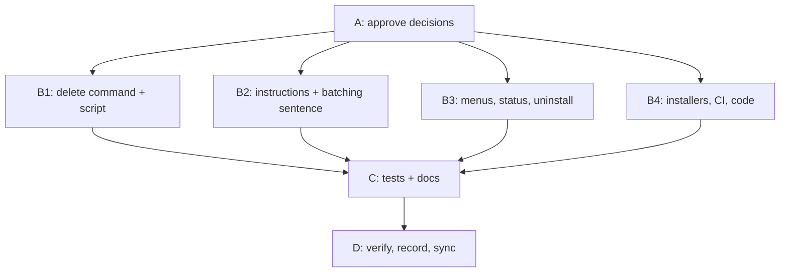

# Archived plan — GOALS 20 — Remove the Contribution Diary (`/diario`)

> Status: completed. Archived from root `GOALS.md` on 2026-10-28.
> This body is a historical snapshot; keep it immutable and add future active work to root `GOALS.md`.

---

## GOALS 20 — Remove the Contribution Diary (`/diario`) (base_project process)

Grounded against commit `d541daf` on 2026-10-27. The owner decided that the contribution diary
is no longer useful and asked to remove everything related to it. The diary touches 54 files:
the command in four runtimes, one script and its test, three global instruction layers, a
sentence repeated in 15 workflow files, the menus, `/status`, `/uninstall`, both installers, CI,
and the docs. The usage ledger and the `usage-log` hook stay, because `/usagebp` reads them.

### Stage map

| Stage | Items | Depends on | Can run in parallel with |
| --- | --- | --- | --- |
| A — Approve decisions | D20.1 | — | — |
| B1 — Delete the command and its script | D20.2–D20.3 | A | B2, B3, B4 |
| B2 — Global instructions and the batching sentence | D20.4–D20.6 | A | B1, B3, B4 |
| B3 — Menus, `/status`, references, `/uninstall` | D20.7–D20.10 | A | B1, B2, B4 |
| B4 — Installers, CI, and the remaining code | D20.11–D20.15 | A | B1, B2, B3 |
| C — Tests and docs | D20.16–D20.20 | B1–B4 | — |
| D — Verify, record, and sync | D20.21–D20.24 | C | — |

D20.5 edits the four `execgoals` files (one sentence). GOALS 19 Stage B2 and GOALS 18 C18.5
edit the same files. D20.6 and D20.16 edit `dev/tests/codex.test.js`, and GOALS 19 Stage C edits
it too. Run those stages one after the other, not in parallel sessions.

<!-- item-contract: v1 -->

### Decisions

- **E1 — Keep the history.** Old `dev/ROADMAP.md` entries, `dev/goals-archive/` (GOALS 5),
  the README changelog lines (`README.md:292`, `:296`), `dev/auditoria-2026-09-24.md`,
  `REPERTOIRE.md`, and the evidence text in other `GOALS.md` sections stay as they are.
- **E2 — Keep the ledger.** `source/hooks/usage-log.js`, `~/.claude/base_project/usage/`, and
  `dev/scripts/ledger-prune.js` stay. Their text changes from "the only source `/diario` has"
  to "what `/usagebp` reads".
- **E3 — Move the large-file test to the remaining reader.** `dev/tests/ledger-scale.test.js`
  tests `readLedger` from `dev/scripts/usage-baseline.js` (it has the same loop guard at
  `usage-baseline.js:121-125`). That function returns `{ events, invalidLines, files }`.
- **E4 — `/uninstall` stops naming the diary folder.** `diary-root.txt` becomes a legacy Tier A
  state file. `/uninstall` does not name or delete the diary folder: it is the user's own folder.
- **E5 — The batching sentence loses "diary".** The new sentence is:
  `Never use batching or stopping to bypass plan or safety boundaries.`
- **E6 — The installers remove stale copies.** On a machine that installed an older version,
  the installers delete `diario.md`, `diary-source.js`, and the Codex `diario` skill, but only
  when the file still has the `base_project:managed` marker. This is the existing pattern
  (`install.ps1:250`, `install.sh:272`, `install-codex.js:132`).
- **E7 — The diary documents are the owner's data.** The plan does not delete them. D20.24 is a
  `manual` item for the owner.

### Stage A — Approve decisions

- [x] **D20.1 Approve decisions E1–E7** (`manual`)
  - Verify: the owner answers "approved" in chat, or lists the changes. Write the date here. Approved on 2026-10-27, no edits.

### Stage B1 — Delete the command and its script

- [x] **D20.2 Delete the four command files** (`coder`)
  - Files: `source/claude/commands/diario.md` (exists), `source/opencode/command/diario.md`
    (exists), `source/opencode/command-lite/diario.md` (exists), `source/codex/skills/diario/`
    (exists)
  - Change: run `git rm -r source/claude/commands/diario.md source/opencode/command/diario.md source/opencode/command-lite/diario.md source/codex/skills/diario`.
  - Verify: `git ls-files | grep -c diario` → `0`.
- [x] **D20.3 Delete the diary script and its test** (`coder`)
  - Files: `dev/scripts/diary-source.js` (exists), `dev/tests/diary-source.test.js` (exists)
  - Do not touch: `dev/scripts/usage-baseline.js`, `dev/scripts/ledger-prune.js`.
  - Change: run `git rm dev/scripts/diary-source.js dev/tests/diary-source.test.js`.
  - Verify: `git ls-files | grep -c diary-source` → `0`.

### Stage B2 — Global instructions and the batching sentence

- [x] **D20.4 Remove the diary section from the three instruction layers** (`coder`)
  - Files: `source/CLAUDE.md` (exists), `source/opencode-instructions.md` (exists),
    `source/codex/AGENTS.md` (exists)
  - Anchor: `### Contribution diary (suggest only, never write unasked)` (both first files);
    `### Contribution Diary` (`source/codex/AGENTS.md`)
  - Change: delete each heading and all lines below it, up to the blank line before the next
    `###` heading. Delete that blank line too.
  - Do not touch: the sections before and after it.
  - Verify: `grep -ci "diar" source/CLAUDE.md source/opencode-instructions.md source/codex/AGENTS.md`
    → only the batching sentence remains before D20.5, and `0` after D20.5.
- [x] **D20.5 Remove "diary" from the batching sentence in 15 files** (`coder`)
  - Files: the 15 files listed by `grep -rl "diary boundaries" source` (exists): `source/CLAUDE.md`,
    `source/opencode-instructions.md`, `source/codex/AGENTS.md`, and `execgoals`, `fixproject`,
    `ship` in `source/claude/commands/`, `source/opencode/command/`,
    `source/opencode/command-lite/`, and `source/codex/skills/*/SKILL.md`.
  - Anchor: `Never use batching or stopping to bypass plan, safety, or diary boundaries.`
  - Change: replace the anchor with the E5 sentence in each file.
  - Do not touch: the rest of the batching block. Its parity test compares it byte for byte.
  - Verify: `grep -rc "diary boundaries" source | grep -vc ":0"` → `0`.
- [x] **D20.6 Update the parity test literal** (`coder`)
  - Files: `dev/tests/codex.test.js` (exists)
  - Anchor: `Never use batching or stopping to bypass plan, safety, or diary boundaries.";`
  - Change: replace `plan, safety, or diary boundaries` with `plan or safety boundaries`.
  - Verify: `node --test dev/tests/codex.test.js` → the test "Batching and stopping guidance has
    exact parity across native layers" passes.

### Stage B3 — Menus, `/status`, references, `/uninstall`

- [x] **D20.7 Remove `/diario` from the three menus** (`coder`)
  - Files: `source/claude/references/command-menu.md` (exists),
    `source/opencode/references/command-menu.md` (exists), `source/codex/references/command-menu.md` (exists)
  - Anchor: the line that starts with ``- `/diario` —`` (Claude, opencode) or ``- `$diario` —`` (Codex).
  - Change: delete that line.
  - Verify: `grep -c "diario" source/*/references/command-menu.md` → `0` for each file.
- [x] **D20.8 Remove `diario` from the `/status` lists** (`coder`)
  - Files: `source/claude/commands/status.md` (exists), `source/opencode/command/status.md` (exists)
  - Anchor: `Commands: newgoal, repertoire, execgoals, scanproject, cleanproject, fixproject, diario, undo,`
  - Change: replace `fixproject, diario, undo` with `fixproject, undo`.
  - Verify: `grep -c "diario" source/claude/commands/status.md source/opencode/command/status.md` → `0` each.
- [x] **D20.9 Remove `diary-root` from the two config-model references** (`coder`)
  - Files: `source/claude/references/config-model.md` (exists), `source/opencode/references/config-model.md` (exists)
  - Anchor: `(repo-path, diary-root, usage ledger` and
    `Existing \`~/.base_project/repo-path.txt\` and \`~/.base_project/diary-root.txt\` stay where they are`
  - Change: replace `(repo-path, diary-root, usage ledger` with `(repo-path, usage ledger`.
    Replace the second anchor with `Existing \`~/.base_project/repo-path.txt\` stays where it is`.
  - Verify: `grep -c "diary" source/*/references/config-model.md` → `0` each.
- [x] **D20.10 Remove the diary from the four `/uninstall` variants** (`coder`)
  - Files: `source/claude/commands/uninstall.md` (exists), `source/opencode/command/uninstall.md`
    (exists), `source/opencode/command-lite/uninstall.md` (exists), `source/codex/skills/uninstall/SKILL.md` (exists)
  - Change (Claude and opencode dense, the same text in both files):
    1. Replace `(usage ledger, diaries, ~/.agents content)` with `(usage ledger, ~/.agents content)`.
    2. Replace `` `opencode-managed-mcp.json`, `diary-root.txt`). `` with
       `` `opencode-managed-mcp.json`, and the legacy `diary-root.txt`). ``
    3. Replace `` the usage ledger `~/.claude/base_project/usage/`, the diary`` + newline +
       `` directory named in `~/.base_project/diary-root.txt`, and the unified canonical store`` with
       `` the usage ledger `~/.claude/base_project/usage/` and the unified canonical store``.
    4. Replace `` state files except `diary-root.txt` (kept with Tier D so the diaries`` + newline +
       `stay findable). Never the usage ledger.` with `state files. Never the usage ledger.`
    5. Replace `(the only source \`/diario\` has for past` + newline + `hours and activity), the diary directory from \`~/.base_project/diary-root.txt\`, and the`
       with `(the source \`/usagebp\` reads), and the`.
    6. Replace `your usage history, diaries and ~/.agents` with `your usage history and ~/.agents`.
  - Change (opencode lite): replace `` `diary-root.txt`). `` with `` the legacy `diary-root.txt`). ``;
    replace `` `~/.claude/base_project/usage/`, the diary directory named in `~/.base_project/diary-root.txt`, and `` with
    `` `~/.claude/base_project/usage/` and ``; replace `` state files except `diary-root.txt`. `` with
    `state files. `; replace `` the usage ledger (the only source `/diario` has for past hours), the diaries, and `` with
    `` the usage ledger (the source `/usagebp` reads) and ``; replace `usage history, diaries and ~/.agents` with
    `usage history and ~/.agents`.
  - Change (Codex): replace `` the usage ledger, the diary directory named in `~/.base_project/diary-root.txt`, and `` with
    `the usage ledger and `; replace `` and state except `diary-root.txt`. `` with
    `` and state (including the legacy `diary-root.txt`). ``; replace
    `` the usage ledger (the only source `$diario` has for past hours), the diaries, and `` with
    `` the usage ledger (the source `$usagebp` reads) and ``.
  - Do not touch: the tier order, the confirmation questions' (y/N) defaults, and Tier D's ledger and `~/.agents/` handling.
  - Verify: `grep -ci "diaries\|diario\|diary directory" source/*/commands/uninstall.md source/opencode/command-lite/uninstall.md source/codex/skills/uninstall/SKILL.md`
    → `0` each; `diff <(sed 's#~/.config/opencode#X#g;s#~/.claude/commands#X#g' source/opencode/command/uninstall.md) <(sed 's#~/.config/opencode#X#g;s#~/.claude/commands#X#g' source/claude/commands/uninstall.md)` → no output.

### Stage B4 — Installers, CI, and the remaining code

- [x] **D20.11 Windows installer: stop copying, start pruning** (`coder`)
  - Files: `dev/scripts/install.ps1` (exists)
  - Anchor: `# 8c-3. diary-source.js - deterministic ledger/git extractor behind /diario.` and
    `(Join-Path $claudeCommandsDir "reviewusage.md"), (Join-Path $opencodeCommandDir "reviewusage.md"))) {`
  - Change: (1) Replace the 8c-3 block, from its comment line through the closing `}` of
    `if (Test-Path $diarySourceSrc)`, with:
    `# 8c-3. Retired: diary-source.js shipped with /diario (removed in GOALS 20).` /
    `$staleDiarySource = Join-Path $claudeScriptsDir "diary-source.js"` /
    `if ((Test-Path $staleDiarySource) -and ((Read-Utf8NoBom $staleDiarySource) -match 'base_project:managed')) {` /
    `    Remove-Item $staleDiarySource -Force` / `    Write-Ok "removed stale script: $staleDiarySource"` / `}`.
    Keep the dashed comment lines around the block. (2) In the stale-command array, replace
    the anchor's `"reviewusage.md"))) {` ending with
    `"reviewusage.md"), (Join-Path $claudeCommandsDir "diario.md"), (Join-Path $opencodeCommandDir "diario.md"))) {`.
  - Verify: `grep -c "Sync-Managed -SrcFile \$diarySourceSrc" dev/scripts/install.ps1` → `0`;
    `grep -c '"diario.md"' dev/scripts/install.ps1` → `2`.
- [x] **D20.12 POSIX installer: stop copying, start pruning** (`coder`)
  - Files: `dev/scripts/install.sh` (exists)
  - Anchor: `# 8c-3. diary-source.js - deterministic ledger/git extractor behind /diario.` and
    `for stale_name in dashboard doctor context explain newproject reviewusage; do`
  - Change: (1) Replace the 8c-3 block, from its comment line through `fi`, with:
    `# 8c-3. Retired: diary-source.js shipped with /diario (removed in GOALS 20).` /
    `STALE_DIARY_SOURCE="$CLAUDE_SCRIPTS_DIR/diary-source.js"` /
    `if [ -f "$STALE_DIARY_SOURCE" ] && grep -q 'base_project:managed' "$STALE_DIARY_SOURCE"; then` /
    `    rm -f "$STALE_DIARY_SOURCE"` / `    ok "removed stale script: $STALE_DIARY_SOURCE"` / `fi`.
    (2) Replace the `for` line with `for stale_name in dashboard doctor context explain newproject reviewusage diario; do`.
  - Verify: `bash -n dev/scripts/install.sh` → exit 0; `grep -c "sync_managed \"\$DIARY_SOURCE_SRC\"" dev/scripts/install.sh` → `0`.
- [x] **D20.13 Codex installer prunes the old skill** (`coder`)
  - Files: `dev/scripts/install-codex.js` (exists)
  - Anchor: `  const staleNames = ["newproject"];`
  - Change: replace it with `  const staleNames = ["newproject", "diario"];`.
  - Verify: `npm run typecheck` → exit 0.
- [x] **D20.14 CI stops expecting the diary and counts 20 skills** (`coder`)
  - Files: `.github/workflows/ci.yml` (exists)
  - Anchor: the six lines that contain `diary-source.js` or `diario.md` (today 76, 102, 131,
    175, 201, 230); `wc -l | tr -d ' ')" = "21"` (147); `-ne 21) { throw "Expected exactly 21 Codex skills" }` (259).
  - Change: delete the six lines. In the PowerShell arrays (175, 201, 230), check the line
    before each deleted line: if the array now ends with a trailing comma, remove that comma.
    Replace `"21"` with `"20"` on line 147. Replace both `21` with `20` on line 259.
  - Verify: `grep -c "diar" .github/workflows/ci.yml` → `0`; the CI `install-test` jobs pass
    after push (checked in D20.21).
- [x] **D20.15 Remove the diary from code comments and maps** (`coder`)
  - Files: `dev/scripts/ledger-prune.js` (exists), `dev/scripts/eval-harness.js` (exists),
    `source/hooks/usage-log.js` (exists), `dev/scripts/usage-baseline.js` (exists)
  - Change:
    1. `ledger-prune.js`: replace `// ledger on its own: it is the only source /diario has for past hours, so the default is to`
       with `// ledger on its own: /usagebp reads it, so the default is to`.
    2. `ledger-prune.js`: replace `` `After that, /diario cannot rebuild hours before ${cutoff}: the ledger is its only source.\n` `` with
       `` `After that, /usagebp cannot report activity before ${cutoff}.\n` ``.
    3. `ledger-prune.js`: replace `/diario can no longer rebuild hours before ${cutoff}.` with
       `/usagebp can no longer report activity before ${cutoff}.`
    4. `eval-harness.js`: replace `// The usage ledger is the only source /diario has for past hours; it once sat inside` with
       `// The usage ledger is user data that /usagebp reads; it once sat inside`.
    5. `usage-log.js`: replace `what /usagebp and /diario actually read` with `what /usagebp actually reads`.
    6. `usage-baseline.js`: delete the line `  diario: "reporting",`.
  - Do not touch: the logic of these files.
  - Verify: `grep -c "diario" dev/scripts/ledger-prune.js dev/scripts/eval-harness.js source/hooks/usage-log.js dev/scripts/usage-baseline.js`
    → `0` each; `npm run lint` → exit 0.

### Stage C — Tests and docs

- [x] **D20.16 Update the tests that name the diary** (`coder`)
  - Files: `dev/tests/codex.test.js` (exists), `dev/tests/menu-rule.test.js` (exists),
    `dev/tests/ledger-prune.test.js` (exists), `dev/tests/ledger-scale.test.js` (exists)
  - Change:
    1. `codex.test.js`: delete the two `assert.match(readSkill("diario"), ...)` statements
       (the first spans four lines). Replace `assert.equal(codex.length, 21);` with
       `assert.equal(codex.length, 20);`. Replace `.length, 21);` with `.length, 20);` in the
       `names(path.join(roots.agents, "skills"), "", true)` assertion.
    2. `menu-rule.test.js`: delete the whole test
       `"the diary suggestion carries its own threshold instead of borrowing the menu rule's"`.
    3. `ledger-prune.test.js`: replace `/\/diario cannot rebuild hours before 2026-06-26/` with
       `/\/usagebp cannot report activity before 2026-06-26/`.
    4. `ledger-scale.test.js`: replace the two `require` lines with
       `const { buildBaseline, readLedger } = require("../scripts/usage-baseline.js");`.
       Rename the second test to `"the usage reader handles a single ledger file larger than the spread-argument limit"`.
       Replace `readLedger(dir).length` with `readLedger(dir).events.length`.
  - Verify: `npm test` → exit 0.
- [x] **D20.17 README: remove the command and fix the counts** (`coder`)
  - Files: `README.md` (exists)
  - Change: delete the table row that starts with ``| `/diario` |``. Replace
    `— it is the only source \`/diario\` has for past hours.` with `— it is what \`/usagebp\` reads.`
    Replace `21` with `20` in the lines that say `All 21 workflows`, `Same 21 commands`,
    `The same 21 workflows`, and `21 workflows ship in total`.
  - Do not touch: the changelog lines (E1).
  - Verify: `grep -n "diario" README.md` → only the two changelog lines; `grep -c "\b21 \(workflows\|commands\)" README.md` → `0`.
- [x] **D20.18 ARCHITECTURE: remove the command and fix the counts** (`coder`)
  - Files: `ARCHITECTURE.md` (exists)
  - Change:
    1. Delete the tree line with `diary-source.js`, the `/diario` row in section 4, and the
       `/diario` and `diary-source.js` rows in the component table.
    2. Replace `ledger de uso, diários, \`~/.agents/\`` with `ledger de uso, \`~/.agents/\``.
       Replace `reinstalando", mas é a única fonte do \`/diario\`.` with `reinstalando", mas é dado do usuário que o \`/usagebp\` lê.`
    3. Replace `isso mantém \`$diario\` compatível` with `isso mantém \`$usagebp\` compatível`.
    4. Replace `é a única fonte do \`/diario\` para` + newline + `horas passadas, então` with
       `é o que o \`/usagebp\` lê, então`.
    5. Replace `21` with `20` in `**21 comandos**`, `(21 comandos`, `mesmos 21 workflows`,
       `## 4. Os 21 comandos`, and `21 skills em`.
  - Verify: `grep -c "diario\|diary-source\|diários" ARCHITECTURE.md` → `0`.
- [x] **D20.19 Repository rules drop the `diario.md` exception** (`coder`)
  - Files: `CLAUDE.md` (exists), `AGENTS.md` (exists)
  - Anchor: `deve casar só nos \`command-menu.md\` **e nos dois \`diario.md\`**. Os \`diario.md\` são exceção`
  - Change: replace the anchor sentence and the rest of that paragraph (through
    `português ali está dentro do bloco de código de exemplo — se aparecer fora dele, aí é drift`
    + `de verdade.`) with `deve casar só nos \`command-menu.md\`.`
  - Verify: `grep -c "diario" CLAUDE.md AGENTS.md` → `0` each.
- [x] **D20.20 Codex docs drop the diary reason** (`coder`)
  - Execution note: also changed the remaining "21" counts in `README.md:102` and four lines of `ARCHITECTURE.md` (tree, section 4, and the test list), and fixed `dev/tests/usage-envelope.test.js` by leaving it as is: it only guards that `/usagebp` never rewrites `diary-root.txt`.
  - Files: `source/codex/README.md` (exists), `source/codex/skills/designreview/SKILL.md` (exists)
  - Change: in `source/codex/README.md` replace
    `so the contribution diary keeps one uninterrupted ledger across Claude and Codex.` with
    `so the usage ledger stays one uninterrupted history across Claude and Codex.`
    In `designreview/SKILL.md` replace `so existing installations and diaries are not split.` with
    `so existing installations are not split.`
  - Verify: `grep -c "diar" source/codex/README.md source/codex/skills/designreview/SKILL.md` → `0` each.

### Stage D — Verify, record, and sync

- [x] **D20.21 Full verification** (`reviewer`)
  - Files: none edited.
  - Verify: `npm run verify` → exit 0; `npm run test:harness` → exit 0;
    `grep -rniE "diario|diary|diários" source dev/scripts dev/tests .github README.md ARCHITECTURE.md CLAUDE.md AGENTS.md`
    → only the README changelog lines and the legacy `diary-root.txt` text in the `/uninstall`
    variants and installers' prune blocks; after push, the CI matrix is green.
- [x] **D20.22 Record the removal in `dev/ROADMAP.md`** (`coder`)
  - Files: `dev/ROADMAP.md` (exists)
  - Change: append `## <next free n>. Remoção do /diario (<date>)` with three short paragraphs in
    Portuguese: why (owner decision), what was removed and what stays (E2), and the evidence
    (the D20.21 result).
  - Verify: `grep -c "Remoção do /diario" dev/ROADMAP.md` → `1`.
- [x] **D20.23 Sync this machine** (`manual`) — writes outside the repository.
  - Execution note: same installer run as P19.20. Output showed `removed stale command` for both `diario.md` files and `removed stale script` for `diary-source.js`; `~/.claude/commands/diario.md` is gone; `~/.claude/CLAUDE.md` has no "Contribution diary" section.
  - Verify: after the owner runs `dev\scripts\install.ps1`, the output shows
    `removed stale command` for both `diario.md` files and `removed stale script` for
    `diary-source.js`; `ls ~/.claude/commands/diario.md` fails; the managed block in
    `~/.claude/CLAUDE.md` has no "Contribution diary" section.
- [x] **D20.24 Decide what to do with the diary documents** (`manual`)
  - Execution note: the owner chose to keep the documents in `D:\ProjetosPessoais\Diarios_contribuicao`. `~/.base_project/diary-root.txt` was deleted on 2026-10-28. `~/.base_project/diario-perfil.json` (a diary profile file) still exists and was not touched.
  - Verify: the owner reads the folder path in `~/.base_project/diary-root.txt`, decides to keep
    or to delete the documents in that folder, and then deletes `diary-root.txt` by hand.
    base_project does not delete these files.

### Explicitly out of scope

- Rewriting history (E1).
- Removing the usage ledger, the `usage-log` hook, `/usagebp`, or `ledger-prune.js` (E2).

### Sources consulted

- Repository files at `d541daf`, found with `grep -rni "diario|diary"` (54 files); exact lines
  are cited in each item.
