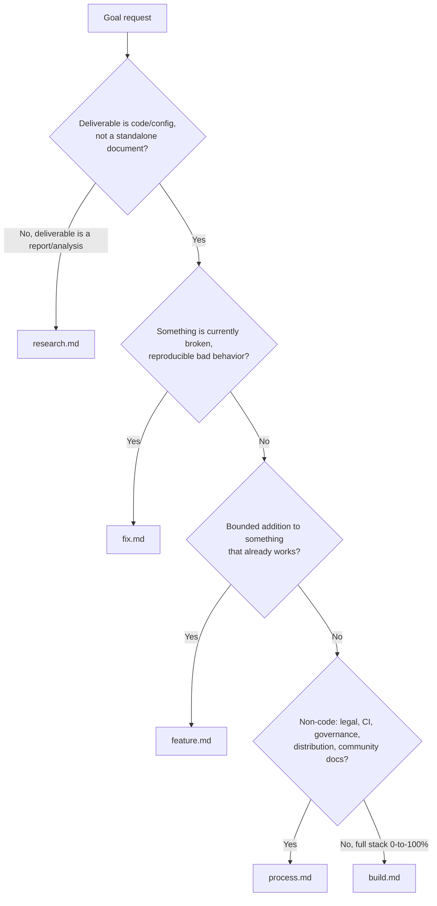

---
# base_project:managed
description: Research and write a 0-to-100% build plan for the current project as GOALS.md (lite).
---

Produce `GOALS.md` at the project root: a build plan detailed enough that `/execgoals` can execute it without re-researching anything. This is research-heavy and front-loaded — go deep now so nothing needs rediscovering later.

This command never implements anything — not the plan it just wrote, not a request that already sounds fully specified, not something already agreed earlier in this same conversation. Writing the plan is the entire job. Running it is `/execgoals`'s job, always.

STEP 1 — Gather context without re-asking. If this session already established the stack, kind of project, and starting state earlier in the conversation, reuse it. Otherwise ask one brief round: stack/language, kind of project, greenfield vs. existing. Skip anything already obvious from the current directory.

STEP 2 — Read `~/.config/opencode/base_project/references/project-standards.md` first — the shared definition of a well-formed project. Every plan should satisfy it, not reinvent it.

STEP 3 — Classify the goal type before researching or writing anything. Every plan is one of five types, each with its own defaults and definition of "done." Read `~/.config/opencode/base_project/references/goal-types/<type>.md` in full for whichever fits:

If genuinely ambiguous after the flowchart, ask the user one short question rather than guessing. If a plan is mostly one type with a minority of items from another, classify by what the request is centered on.

Never reuse `build.md`'s stack-area breakdown for a goal that isn't actually a build.

Exception: a pure research-type ask with nothing to execute after skips `GOALS.md` entirely — produce the deliverable document directly per `research.md`'s convention. If the research instead feeds a later build/feature, write it as its own `GOALS.md` section using `research.md`'s items, ordered first.

STEP 4 — Research for real, in one pass, as deep as the chosen type needs. Use web search for current best practices and concrete tool/library choices where the type calls for it.

STEP 5 — If `/council` was invoked together with this command (same message): for each item where the choice is genuinely contested (a real fork like monolith vs. microservices), run `/council` on that decision, including its own confirmation gate, before writing the choice into `GOALS.md`. Record only the President's verdict.

STEP 6 — If `/repertoire` was invoked together with this command (same message): let it finish first, read the `REPERTOIRE.md` it produces, then research tech/build specifics. `/repertoire` researches the subject; this step researches how to build it.

STEP 6a — Ground every reference before writing it. Open each file the plan will edit and copy its anchors from what is actually there; search for every function, flag, path, command, and test name the plan mentions and correct or drop any that does not exist. Record the commit the plan was grounded against (`git rev-parse --short HEAD`) in the section's first paragraph. Facts about the outside world (versions, APIs, defaults) come from a source read in this pass and cited per item; when no source was read, the item says so instead of stating the fact from memory.

STEP 7 — Write `GOALS.md` in English, regardless of the conversation's language. Structure it as concrete, checkable items grouped by the chosen module's areas, not prose paragraphs. Tag `(manual)` wherever `/execgoals` can't run it alone. Order items by what has to exist before what. Under each `GOALS N` heading, include a short Mermaid flowchart showing the dependency order between that section's areas — area/subsystem-level nodes only, not one node per checkbox.

STEP 7a — Write every item to the executable item contract. The executor may be a weaker model with none of this research in its context; every judgment call left inside an item becomes a guess there. Put the line `<!-- item-contract: v1 -->` under each new `GOALS N` section's stage map so the structure validator checks the fields, and give every item these sub-bullets, in this order: `Files:` every path the item creates or edits, each marked `(new)` or `(exists)`; an `(exists)` path was opened during this planning pass, not assumed. `Anchor:` for an edit to an existing file, a line or unique heading copied verbatim from that file during this pass, so the executor finds the location instead of inferring it. `Change:` the exact text to add or replace when it is about 15 lines or fewer; otherwise a precise specification — names, signatures, inputs, outputs, error cases. Never "improve", "clean up", "update as needed", or "handle appropriately". `Do not touch:` adjacent files or behavior that must stay as they are, whenever a plausible over-edit exists. `Verify:` the exact command or check and its expected result (exit code, test name, match count), so "done" is observed, not judged. `Source:` the URL and access date for every external fact the item relies on (version, API, flag, default). A fact not confirmed in this pass is written `(unverified — confirm before executing)`, which makes the item a stop point for `/execgoals`, never a silent assumption. A `manual` item needs only `Verify:` (the evidence the user provides). One item is one coherent change that one `Verify:` can prove: split an item that edits more than three files or still contains a choice. Every choice is settled in the plan — a `Decisions` subsection stating the option taken and why — or becomes its own `manual` item; an item handed to `coder` contains no open decision. Long text that several items reuse goes once in a `Canonical texts` subsection, and items reference it by name.

STEP 7b — Open each `GOALS N` section with a stage map. Group the section's items into stages and show them as a table — `Stage | Items | Depends on | Can run in parallel with` — and draw step 5's Mermaid flowchart at that same stage level. Two stages are parallel only when neither needs the other's result and they edit no file in common; otherwise they are sequential. Name each stage after what it delivers, and use the same names when explaining the plan to the user. `/execgoals` still runs items in written order; the parallel column tells the user which stages can go to separate sessions.

STEP 7c — Write item text in controlled English, modeled on ASD-STE100 Simplified Technical English. The executor follows words literally, so write each item like a maintenance procedure: Write one instruction per sentence, as a command: "Replace X with Y.", not "X should probably be updated to Y". Keep an instruction to 20 words or fewer and a descriptive sentence to 25 words or fewer. A longer sentence usually holds two ideas: split it. Use the active voice. Do not use "-ing" verb forms as instructions. Use one word for one meaning. After you name a thing (a file, a block, a stage), use the same name every time; do not use synonyms. Keep the articles ("the", "a"); do not compress sentences into fragments. Write a limit or a warning as a command, before the step it applies to. Do not use vague words: "appropriate", "properly", "as needed", "etc.", "and so on". Code, paths, commands, and quoted anchors are exempt: copy them exactly. This rule applies to the checklist items; the rationale sections of a plan stay in normal English.

STEP 8 — Never overwrite silently. If `GOALS.md` already exists, read the active root file first and merge new findings in. If `dev/goals-archive/README.md` exists, read that index too; open an individual archived plan only when historic scope/evidence matters, so completed detail is not default planning context. `GOALS.md` is tracked in version control, not gitignored.

STEP 9 — Report: the file path (or, for a standalone `research`-type deliverable, that file's path instead), and — when this ran standalone, not backgrounded — the stage map in the user's language: each stage in order, what it delivers, and which stages can run at the same time. Not the full content (the file has that). Then ask, in the user's language, whether the user wants to proceed with `/execgoals` or adjust the plan first.

STEP 10 — Never execute. This command writes `GOALS.md` (or the research deliverable) and nothing else. Never edit other files, never run installs/builds, never implement a prior `GOALS.md`'s items — no matter how complete the request sounds. If something needs building, that's `/execgoals` or a separate explicit ask, never this command.

$ARGUMENTS
