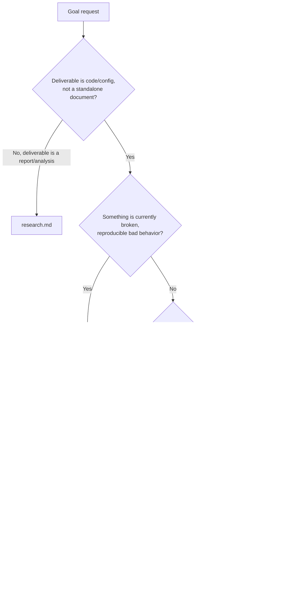

---
# base_project:managed
description: Research and write a 0-to-100% build plan for the current project as GOALS.md (lite).
---

Produce `GOALS.md` at the project root: a build plan detailed enough that `/execgoals` can execute it without re-researching anything. This is research-heavy and front-loaded — go deep now so nothing needs rediscovering later.

This command never implements anything — not the plan it just wrote, not a request that already sounds fully specified, not something already agreed earlier in this same conversation. Writing the plan is the entire job. Running it is `/execgoals`'s job, always.

STEP 1 — Gather context without re-asking. If this session already established the stack, kind of project, and starting state earlier in the conversation, reuse it. Otherwise ask one brief round: stack/language, kind of project, greenfield vs. existing. Skip anything already obvious from the current directory.

STEP 2 — Read `~/.config/opencode/base_project/references/project-standards.md` first — the shared definition of a well-formed project. Every plan should satisfy it, not reinvent it.

STEP 3 — Classify the goal type before researching or writing anything. Every plan is one of five types, each with its own defaults and definition of "done." Read `~/.config/opencode/base_project/references/goal-types/<type>.md` in full for whichever fits:

If genuinely ambiguous after the flowchart, ask the user one short question rather than guessing. If a plan is mostly one type with a minority of items from another, classify by what the request is centered on.

Never reuse `build.md`'s stack-area breakdown for a goal that isn't actually a build.

Exception: a pure research-type ask with nothing to execute after skips `GOALS.md` entirely — produce the deliverable document directly per `research.md`'s convention. If the research instead feeds a later build/feature, write it as its own `GOALS.md` section using `research.md`'s items, ordered first.

STEP 4 — Research for real, in one pass, as deep as the chosen type needs. Use web search for current best practices and concrete tool/library choices where the type calls for it.

STEP 5 — If `/council` was invoked together with this command (same message): for each item where the choice is genuinely contested (a real fork like monolith vs. microservices), run `/council` on that decision, including its own confirmation gate, before writing the choice into `GOALS.md`. Record only the President's verdict, as a `### Decisions` line.

STEP 6 — If `/repertoire` was invoked together with this command (same message): let it finish first, read the `REPERTOIRE.md` it produces, then research tech/build specifics. `/repertoire` researches the subject; this step researches how to build it.

STEP 7 — Write `GOALS.md` in English as an executor-v1 plan. Read `~/.config/opencode/base_project/references/ai-writing-standard.md` first. Follow its Part A and its glossary. The user does not read this file; `/execgoals` and its executors do. Write for an executor that cannot ask questions and makes no design choice.
- Under the `## GOALS N — <title> (<project> <type>)` heading, write the line `Format: executor-v1`. Then write a scope of three sentences or fewer.
- Write `### Decisions` next, one line per decision: `- D<n> <decision>. Why: <one clause>. Source: <URL or file>.` No item holds an open choice.
- Group items by the goal type's areas, in the type's order. Start each item with `- [ ] **<ID> <imperative title>**`. Give it these sub-bullets: `tier: <light|standard|strong> · <low|medium|high|xhigh>`, `gate: <auto|notify|ask>`, `after: <item IDs, or none>`, `files: <paths> (new|edit)`, `do:` with numbered steps, `check: <command run from the project root> → <expected result>`. `stop-if: <condition>` is optional.
- One item is one executor run: 5 files or fewer and 10 steps or fewer. Split a larger item.
- Give the exact text to write, the exact anchor line, exact names and values.
- `check:` must be a command whose exit code or output proves the item. The executor's report is never proof.
- Owner work: `tier: user`, `gate: ask`, `check: manual — <what the user observes>`.
- Tier: `light` when the step gives the exact content; `standard` for code from a clear spec; `strong` for logic across files, open debugging, or security. Use effort `xhigh` only for irreversible, security, or migration work.
- Gate: `auto` for reversible work inside the repository; `notify` when the effect is visible; `ask` for irreversible or external work, credentials, or a material choice.
- Do not write a Mermaid diagram or a `Suggested:` line. `after:` is the order; `tier:` is the routing.

STEP 8 — Never overwrite silently. If `GOALS.md` already exists, read the active root file first and merge new findings in. If `dev/goals-archive/README.md` exists, read that index too; open an individual archived plan only when historic scope/evidence matters, so completed detail is not default planning context. Read the `## Owner backlog` section of the root `GOALS.md` if it exists; do not repeat its items in a new plan. `GOALS.md` is tracked in version control, not gitignored.

STEP 9 — Report in the user's language, answer first, in five lines or fewer: the file path (or the research deliverable's path), the number of items per tier, the items with `gate: ask` or `tier: user`, and the session model for `/execgoals`. That session only dispatches, runs checks and escalates: recommend a mid-tier model at medium effort unless an `ask` item needs more. This is a recommendation only; it switches nothing. Do not describe the items. Then ask whether to run `/execgoals` or adjust the plan.

STEP 10 — Never execute. This command writes `GOALS.md` (or the research deliverable) and nothing else. Never edit other files, never run installs/builds, never implement a prior `GOALS.md`'s items — no matter how complete the request sounds. If something needs building, that's `/execgoals` or a separate explicit ask, never this command.

$ARGUMENTS
