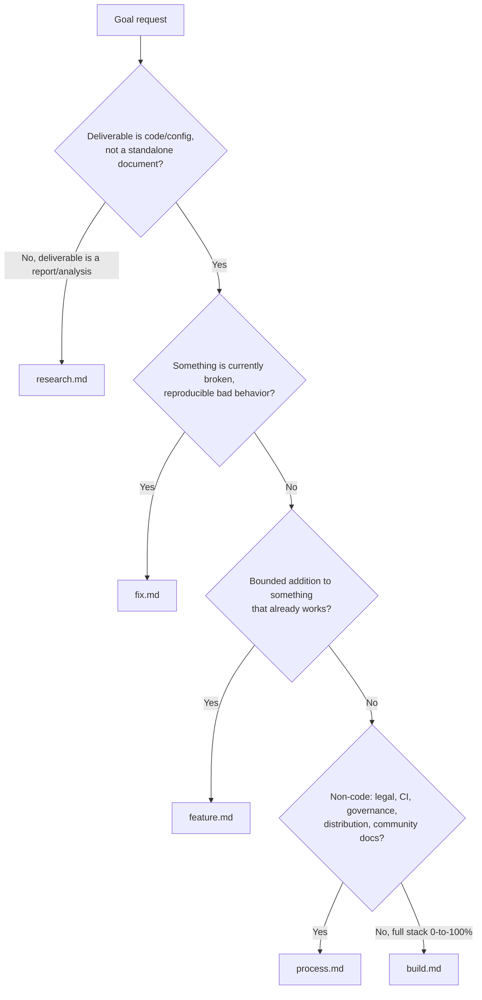

---
# base_project:managed
description: Research and write a 0-to-100% build plan for the current project as GOALS.md (lite).
---

Produce `GOALS.md` at the project root: a build plan detailed enough that `/execgoals` can execute it without re-researching anything. This is research-heavy and front-loaded — go deep now so nothing needs rediscovering later.

This command never implements anything — not the plan it just wrote, not a request that already sounds fully specified, not something already agreed earlier in this same conversation. Writing the plan is the entire job. Running it is `/execgoals`'s job, always.

STEP 1 — Gather context without re-asking. If this session already established the stack, kind of project, and starting state earlier in the conversation, reuse it. Otherwise ask one brief round: stack/language, kind of project, greenfield vs. existing. Skip anything already obvious from the current directory.

STEP 2 — Read `~/.config/opencode/base_project/references/project-standards.md` first — the shared definition of a well-formed project. Every plan should satisfy it, not reinvent it.

STEP 3 — Classify the goal type before researching or writing anything. Every plan is one of five types, each with its own defaults and definition of "done." Read `~/.config/opencode/base_project/references/goal-types/<type>.md` in full for whichever fits:

If genuinely ambiguous after the flowchart, ask the user one short question rather than guessing. If a plan is mostly one type with a minority of items from another, classify by what the request is centered on.

Never reuse `build.md`'s stack-area breakdown for a goal that isn't actually a build.

Exception: a pure research-type ask with nothing to execute after skips `GOALS.md` entirely — produce the deliverable document directly per `research.md`'s convention. If the research instead feeds a later build/feature, write it as its own `GOALS.md` section using `research.md`'s items, ordered first.

STEP 4 — Research for real, in one pass, as deep as the chosen type needs. Use web search for current best practices and concrete tool/library choices where the type calls for it.

STEP 5 — If `/council` was invoked together with this command (same message): for each item where the choice is genuinely contested (a real fork like monolith vs. microservices), run `/council` on that decision, including its own confirmation gate, before writing the choice into `GOALS.md`. Record only the President's verdict, as a `### Decisions` line.

STEP 6 — If `/repertoire` was invoked together with this command (same message): let it finish first, read the `REPERTOIRE.md` it produces, then research tech/build specifics. `/repertoire` researches the subject; this step researches how to build it.

STEP 6a — Ground every reference before writing the plan. Open each file the plan will edit. Copy each anchor from the current file. Search for every path, symbol, command, flag, and test name. Correct or remove each reference that does not exist. Record `git rev-parse --short HEAD` in the section's first paragraph. Cite each external fact per item. If a fact is unverified, write `(unverified — confirm before executing)`; the executor must stop at that item.

STEP 7 — Write `GOALS.md` in English as an executor-v1 plan. Read `~/.config/opencode/base_project/references/ai-writing-standard.md` first. Follow Part A and its glossary. The user does not read this file; `/execgoals` and its executors do. Write for an executor that cannot ask questions or make design choices.
- Under each `## GOALS N — <title> (<project> <type>)` heading, write `Format: executor-v1`, then a scope of three sentences or fewer and a `### Decisions` list that settles every choice.
- Group items by the selected goal type's areas, in their required order. Start each item with `- [ ] **<ID> <imperative title>**`.
- Give each item these required fields: `tier: <light|standard|strong> · <low|medium|high|xhigh>`, `gate: <auto|notify|ask>`, `after: <item IDs, or none>`, `files:`, numbered `do:` steps, and `check:`.
- Mark every path in `files:` as `(new)` or `(exists)`. Add the exact `Anchor:`, `Change:`, `Do not touch:`, `Verify:`, and `Source:` details. Use an anchor copied from the current file. Give exact text or a precise specification. Give the check command and its expected result. Cite external facts with a URL and access date.
- Mark user work as `tier: user`, `gate: ask`, and `check: manual — <what the user observes>`. Use effort `xhigh` only for irreversible, security, or migration work.
- Keep each item to three files or fewer and ten steps or fewer. Split work that exceeds either limit or still has a choice.
- Open each section with a stage map table: `Stage | Items | Depends on | Can run in parallel with`. Put `<!-- item-contract: v1 -->` under the table. Do not include a Mermaid diagram or recommend a model or effort.
- Write checklist items in controlled English, modeled on ASD-STE100. Use one instruction per sentence. Keep instructions to 20 words or fewer and descriptive sentences to 25 words or fewer. Use active voice, stable names, articles, and concrete words. Do not use vague terms such as "as needed" or "etc."

STEP 8 — Never overwrite silently. If `GOALS.md` exists, read and merge the active root plan. If `dev/goals-archive/README.md` exists, read its index and open an archived plan only when its history matters. Read the `## Owner backlog` section if it exists; do not repeat its items. Keep `GOALS.md` tracked in version control.

STEP 9 — Report in the user's language, answer first, in five lines or fewer. State the file path, item count per tier, and every `gate: ask` or `tier: user` item. Include the stage map when this command runs directly. Do not describe the items or recommend a model or effort. Ask whether the user wants to proceed with `/execgoals` or adjust the plan first.

STEP 10 — Never execute. This command writes `GOALS.md` (or the research deliverable) and nothing else. Never edit other files, never run installs/builds, never implement a prior `GOALS.md`'s items — no matter how complete the request sounds. If something needs building, that's `/execgoals` or a separate explicit ask, never this command.

$ARGUMENTS
